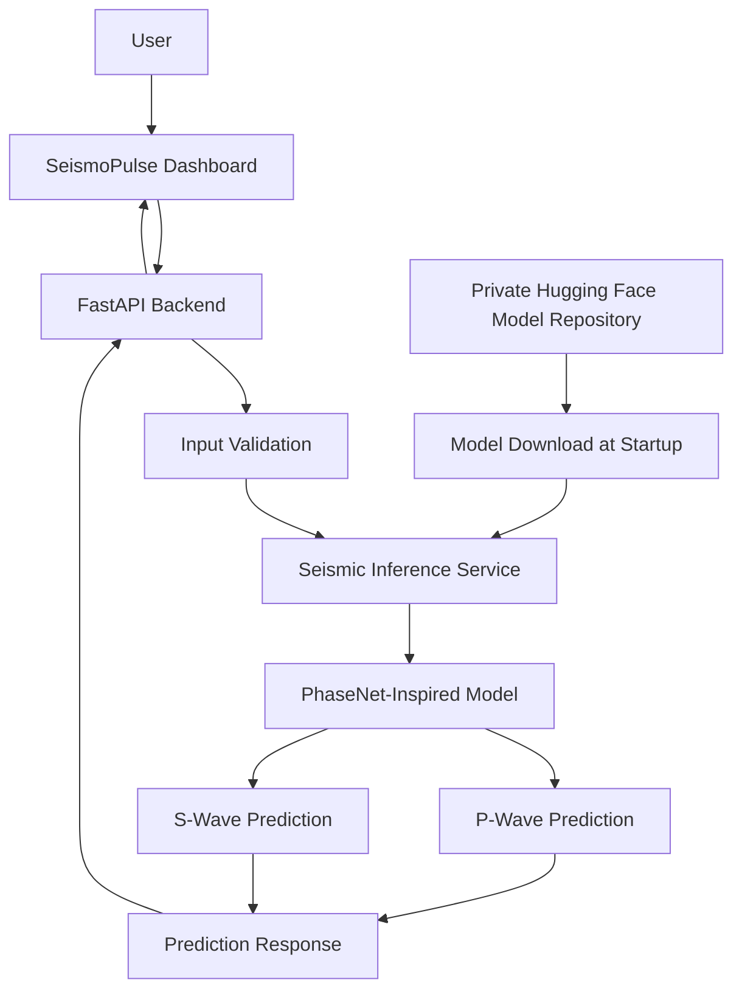
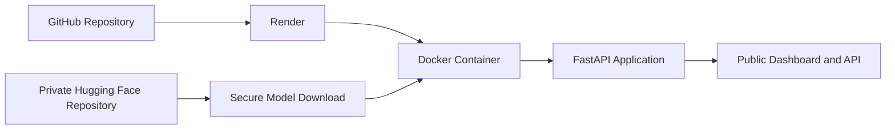

# SeismoPulse
### AI-Powered Seismic Phase Detection & Waveform Analysis Platform

<p align="center">
  <strong>Detect. Analyze. Understand.</strong>
</p>

<p align="center">
  An end-to-end deep learning platform for detecting P-wave and S-wave arrivals in three-component seismic waveform data.
</p>

<p align="center">
  <a href="https://seismopulse-api.onrender.com/dashboard">Live Dashboard</a> ·
  <a href="https://seismopulse-api.onrender.com/docs">API Documentation</a> ·
  <a href="https://seismopulse-api.onrender.com/api/model-info">Model Information</a>
</p>

<p align="center">
  
  
  
  
  
  
  
</p>

---

## 1. Overview

**SeismoPulse** is an AI-powered seismic waveform analysis platform designed to identify two important seismic phases: Primary (P) waves and Secondary (S) waves.

The platform uses a custom-trained, PhaseNet-inspired deep learning architecture to analyze three-component seismic signals and estimate the arrival times of seismic phases.

Traditional seismic phase identification often requires expert interpretation of waveform patterns. SeismoPulse explores how deep learning can assist this process by generating automated phase predictions and presenting the results through an interactive analysis dashboard.

The project brings together deep learning, scientific signal processing, API engineering, containerization and cloud deployment into one integrated application.

### Key capabilities

- Automated P-wave and S-wave phase prediction.
- Three-component seismic waveform input.
- Deep learning inference using a trained PhaseNet-inspired model.
- Interactive waveform analysis dashboard.
- Configurable P- and S-phase detection thresholds.
- REST API for waveform prediction.
- Demo, validation and custom JSON waveform workflows.
- Docker-based application deployment.
- Private model checkpoint hosting through Hugging Face.
- Public cloud deployment through Render.

---

## 2. Problem Statement

Seismic waveform interpretation is an important component of earthquake monitoring and seismological research.

Identifying the arrival times of P-waves and S-waves is essential for subsequent seismic analysis, including event characterization and earthquake location workflows.

However, manual waveform interpretation can be time-consuming, particularly when processing large collections of seismic recordings.

SeismoPulse investigates a deep learning-based approach to automate seismic phase identification and make waveform analysis accessible through an interactive software platform.

**Objective:** Develop an end-to-end system that accepts seismic waveform data, performs automated phase inference and presents predicted seismic arrivals in an understandable visual interface.

---

## 3. System Architecture

SeismoPulse follows a modular architecture that separates the user interface, API layer, inference service, trained model and model artifact storage.



### Architecture components

| Component | Responsibility |
|---|---|
| Frontend | Waveform input, visualization and prediction presentation |
| FastAPI | REST API and request handling |
| Input validation | Validates waveform dimensions and sample properties |
| Inference service | Loads the model and executes predictions |
| PhaseNet-inspired model | Estimates seismic phase probabilities |
| Hugging Face | Private checkpoint storage |
| Docker | Reproducible application packaging |
| Render | Public cloud hosting |

---

## 4. Deep Learning Approach

SeismoPulse uses a custom-trained, PhaseNet-inspired neural network for seismic phase detection.

The model processes three-component seismic waveform data and produces phase-related predictions.

### Input representation

The model accepts three-component waveform data:

- Vertical component
- North-South component
- East-West component

The application uses a sampling rate of **100 Hz**.

Conceptually, the waveform can be represented as:

\[
X \in \mathbb{R}^{N \times 3}
\]

Where:

- \(N\) represents the number of waveform samples.
- \(3\) represents the three seismic components.

The inference implementation also supports the corresponding channel-first representation.

### Prediction classes

The model uses three output classes:

| Class | Meaning |
|---|---|
| Noise | Background seismic signal |
| P | Primary-wave phase |
| S | Secondary-wave phase |

### Prediction workflow

1. Receive three-component seismic waveform data.
2. Validate the input structure and sampling information.
3. Pass the waveform through the trained neural network.
4. Obtain phase-related prediction probabilities.
5. Apply configurable P- and S-phase thresholds.
6. Identify candidate phase arrivals.
7. Return predictions through the API.
8. Visualize the results in the dashboard.

### Current inference configuration

| Parameter | Configuration |
|---|---|
| Model architecture | PhaseNet-inspired |
| Input components | 3 |
| Sampling rate | 100 Hz |
| Output classes | Noise, P, S |
| P threshold | 0.30 |
| S threshold | 0.30 |
| Inference device | CPU |
| Checkpoint epoch | 5 |

These are the current application settings, not independently validated performance metrics.

---

## 5. Technology Stack

| Technology | Usage |
|---|---|
| Python | Core application and ML implementation |
| PyTorch | Neural network training and inference |
| NumPy | Numerical waveform processing |
| FastAPI | Backend API |
| Pydantic | Request validation |
| HTML, CSS, JavaScript | Interactive frontend |
| Docker | Containerization |
| Hugging Face Hub | Private model checkpoint distribution |
| Render | Cloud deployment |
| Git & GitHub | Version control and source management |

---

## 6. Application Features

### Interactive seismic dashboard

The dashboard provides an interface for interacting with the seismic inference system.

Current workflows include:

- Running predictions using demo waveform data.
- Running predictions using validation waveform data.
- Uploading custom JSON waveform data.
- Visualizing seismic waveform information.
- Displaying predicted P- and S-phase arrivals.

### REST API

The backend exposes endpoints for application health, model information and seismic prediction.

| Endpoint | Method | Purpose |
|---|---|---|
| `/` | GET | Application health |
| `/api/model-info` | GET | Model loading and configuration information |
| `/api/predict` | POST | Generate seismic phase predictions |
| `/dashboard` | GET | Interactive dashboard |
| `/docs` | GET | Interactive API documentation |

The API documentation is generated using FastAPI and OpenAPI.

---

## 7. Input Data Format

Custom waveform prediction accepts JSON input.

A simplified conceptual example:

```json
{
  "source": "custom-recording",
  "sample_rate_hz": 100,
  "waveform": [
    [0.12, 0.08, 0.15],
    [0.14, 0.09, 0.13],
    [0.11, 0.10, 0.16]
  ]
}
```

Each waveform row represents one time sample containing the three seismic components.

The actual API request must satisfy the application's input validation requirements, including waveform length and finite numerical values.

---

## 8. Deployment Architecture

SeismoPulse is deployed as a containerized cloud application.

The model checkpoint is maintained separately from the source-code repository.



### Deployment workflow

1. Source code is maintained in GitHub.
2. Render builds the application using the Dockerfile.
3. The application reads its Hugging Face access token from a secure environment variable.
4. The private model checkpoint is downloaded during startup.
5. PyTorch loads the checkpoint on CPU.
6. FastAPI exposes the prediction service.
7. Users access the dashboard through the public Render URL.

### Security considerations

- Model weights are not committed to GitHub.
- The Hugging Face model repository is private.
- Access credentials are configured through Render environment variables.
- Sensitive tokens are excluded from source control.
- The model checkpoint is stored separately from application source code.

---

## 9. Run Locally with Docker

### Prerequisites

- Git
- Docker Desktop
- Access to the private model checkpoint
- Hugging Face read token

### Clone the repository

```bash
git clone https://github.com/myogeswar65-cmd/SeismoPulse.git

cd SeismoPulse
```

### Build the Docker image

```bash
docker build -t seismopulse:latest .
```

### Run the application

Make sure your checkpoint is available locally, then run:

```bash
docker run -d \
  --name seismopulse \
  -p 8000:8000 \
  -e SEISMOPULSE_MODEL_PATH=/models/phase_net_best.pt \
  -v /path/to/phase_net_best.pt:/models/phase_net_best.pt:ro \
  seismopulse:latest
```

Replace `/path/to/phase_net_best.pt` with the actual checkpoint path on your system.

### Access the application

| Resource | URL |
|---|---|
| Dashboard | http://localhost:8000/dashboard |
| API health | http://localhost:8000/ |
| Model information | http://localhost:8000/api/model-info |
| API documentation | http://localhost:8000/docs |

---

## 10. Live Deployment

The application is publicly deployed on Render.

**Live Dashboard:**  
https://seismopulse-api.onrender.com/dashboard

**API Health:**  
https://seismopulse-api.onrender.com/

**Model Information:**  
https://seismopulse-api.onrender.com/api/model-info

**API Documentation:**  
https://seismopulse-api.onrender.com/docs

### Model verification

The deployed model information endpoint confirms:

- Model loaded successfully.
- Checkpoint epoch: 5.
- Inference device: CPU.
- Sampling rate: 100 Hz.
- P- and S-phase thresholds: 0.30.

The free hosting configuration may experience cold starts after periods of inactivity. The downloaded model is stored in the service's temporary filesystem and may need to be downloaded again after a restart.

---

## 11. Repository Structure

```text
SeismoPulse/
│
├── backend/
│   └── app/
│       ├── api/
│       │   └── main.py
│       ├── schemas/
│       │   └── prediction.py
│       └── services/
│           └── model_service.py
│
├── frontend/
│   └── index.html
│
├── src/
│   └── seismopulse/
│       ├── models/
│       │   └── phase_net.py
│       └── inference/
│           └── phase_picker.py
│
├── scripts/
│
├── Dockerfile
├── requirements.txt
├── pyproject.toml
├── .dockerignore
└── .gitignore
```

Training datasets, experiment outputs and model checkpoints are maintained separately and are not included in the public source-code history.

---

## 12. Current Limitations

SeismoPulse is an experimental research and engineering prototype.

The current implementation should not be interpreted as a validated earthquake early-warning system.

Known areas requiring further work include:

- Evaluation on larger and independent seismic datasets.
- Cross-dataset generalization.
- Quantitative P- and S-phase arrival-time error analysis.
- Precision, recall and F1-score reporting.
- Robustness under different noise conditions.
- Performance benchmarking under realistic workloads.
- Validation against expert-reviewed phase arrival annotations.

No unsupported accuracy or real-world detection claims are made.

---

## 13. Future Development

Planned research and engineering directions include:

- Expanded seismic dataset evaluation.
- Improved phase arrival-time estimation.
- Noise robustness and generalization studies.
- Confidence calibration.
- Batch waveform processing.
- Event-level seismic analysis.
- Performance optimization.
- Research-grade evaluation and documentation.

---

## 14. Research and Engineering Focus

SeismoPulse brings together several areas of applied AI engineering:

- Deep learning for scientific signal processing.
- Time-series and waveform analysis.
- Neural network inference.
- REST API design.
- Model artifact management.
- Secure cloud deployment.
- Interactive scientific visualization.

The project is intended as a foundation for further experimentation in automated seismic signal analysis.

---

## 15. Author

**Yogeswar Maddikuntla**

AI Engineer | Generative AI | Machine Learning | Deep Learning

GitHub: [@myogeswar65-cmd](https://github.com/myogeswar65-cmd)

---

## 16. Disclaimer

SeismoPulse is developed for educational, research and experimental purposes.

Its predictions are not a substitute for official seismic monitoring systems, expert seismological interpretation or government-issued earthquake warnings.

The project has not been certified for operational earthquake early-warning or public-safety applications.

---

<p align="center">
  <strong>SeismoPulse — Turning Seismic Signals into Interpretable AI Predictions.</strong>
</p>
